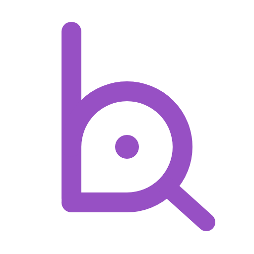

<p align="center">
  <picture>
    <source media="(prefers-color-scheme: dark)" srcset="assets/icon-dark.png">
    
  </picture>
</p>

<h1 align="center">vibebiz</h1>

<p align="center"><strong>You think business. vibebiz writes it like a product owner.</strong><br>
A plugin that interviews founders and business leaders until an idea is clear, challenged and measurable, then packages it for the board and the tech team, in Claude Cowork (its main app), Claude Code, Codex and Antigravity. It is a set of instructions the app follows and runs no program of its own; what it writes goes only to your folder or your own Google Drive.</p>

<p align="center">
  <a href="https://github.com/finolabs/vibebiz/releases/latest"></a>
  <a href="LICENSE"></a>
  <a href="#cowork-main-app"></a>
  <a href="#claude-code"></a>
  <a href="#codex"></a>
  <a href="#antigravity"></a>
</p>

Vietnamese version: [README.vi.md](README.vi.md)

## What ships

vibebiz ships six skills. Each command is a skill of the same name; you can also just say what you want in plain words. The commands below are written as Cowork and Claude Code show them; in Codex type `$idea`, in Antigravity `/idea`, and so on.

- `/vibebiz:idea`: start a new idea. Sets up the workspace in your folder if needed, asks about a real recent case, drafts a first requirement with every gap marked, then interviews you in short rounds (at most four multiple-choice questions, recommended answer first) and saves every answer.
- `/vibebiz:continue`: pick an idea back up. Re-reads its files (your own edits win), summarizes in three lines what is settled, where it stopped and the next question, then continues the rounds. Also records board outcomes (approved, rejected, needs changes) and tech team reviews of estimates.
- `/vibebiz:package`: package a clarified idea for the board and the tech team. Checks readiness (or offers a labelled draft), builds the plan, checks for gaps and contradictions, then makes a board deck and a requirements document as private Claude Artifacts (web pages in the idea folder in apps without Artifacts) or your own Google Slides and Docs, plus a Spec Kit-compatible requirement file. The same figures appear in every view with their source; earlier versions are kept. Nothing is shared or made public.
- `/vibebiz:status`: list every idea with its status, how many of the 15 points are clear and the next step. Asks nothing.
- `/vibebiz:constitution`: record or update your organization's ground rules in one round of at most four questions: this year's priorities, the budget you approve alone, your business, and the steps that always need a person to approve; optionally your strategy objectives and OKRs. Skip it and the rules stay "later". Challenge and planning check every idea against them, and the plan and the board deck show any conflict. Changing a recorded rule shows the change and asks before saving.
- `/vibebiz:help`: guide you to the right command for your situation and answer questions from the shipped documentation, citing the section. Reads a skill's current instructions before describing it, points to a fictional example idea (`examples/`) on request, and writes nothing to the workspace.

Commands in Vietnamese: [docs/commands.md](docs/commands.md).

## What vibebiz is

You start with something like "we should use AI to bring lapsed customers back". vibebiz asks one short round of questions at a time, writes every answer to files in your folder, questions the idea honestly (including "do nothing" and "fix the process"), and makes sure every goal has a baseline, a target and a way to measure it. When the idea is ready it produces two views from one source: a board deck and a tech PRD. The board deck uses an infographic format (one central visual per slide, few words, takeaway in the title). The tech view includes a requirement file in a format compatible with Spec Kit, so your developers can plan from it without rework.

vibebiz is not a coding tool. In Cowork you never need a terminal; in Claude Code, Codex and Antigravity, installing it takes one or two typed lines, and after that you work in plain conversation.

## Who it is for

Founders and leaders of small and mid-sized businesses who are not technical, who own an idea for a system, an AI use or an automation and need to take it to their board and a tech team. Retail comes first, online or offline (fashion first; electronics, home appliances and similar next): the examples and knowledge packs that ship today are for retail. Outputs and questions use the language you speak with it, Vietnamese by default.

## Install at a glance

- **Cowork**: download `vibebiz.plugin` from the latest [release](https://github.com/finolabs/vibebiz/releases), then in Cowork open Settings › Plugins › "Upload plugin". No terminal.
- **Claude Code**, in a terminal:

  ```bash
  claude plugin marketplace add finolabs/plugins
  claude plugin install vibebiz@finolabs
  ```

- **Codex**, in a terminal:

  ```bash
  codex plugin marketplace add finolabs/plugins
  codex plugin add vibebiz@finolabs
  ```

- **Antigravity**, in a terminal:

  ```bash
  agy plugin install https://github.com/finolabs/vibebiz
  ```

Details, and what to do if the catalog does not list vibebiz yet: [Install](#install).

## Start here

1. Ask your assistant to install vibebiz for you, or follow [Install at a glance](#install-at-a-glance).
2. Open an empty folder in the app, or connect Google Drive where the app cannot open a folder (Cowork on the web or a phone).
3. Type `/vibebiz:idea` (Codex: `$idea`; Antigravity: `/idea`), or just describe your idea in plain words.
4. It worked when vibebiz asks about a real, recent case that led to your idea and the folder gets a table of contents.

## For AI agents

1. Find the host you run in: Claude Cowork, Claude Code, Codex or Antigravity.
2. Confirm with the user that they want vibebiz installed there.
3. Check for an existing copy: `claude plugin list` (look for `vibebiz@synced` or `vibebiz@finolabs`), `codex plugin list`, or `agy plugin list`. Keep one copy ([FAQ 13](docs/faq.md), [FAQ 16](docs/faq.md)).
4. Install with the command for that host in [Install](#install). In Cowork, the user uploads `vibebiz.plugin` themselves.
5. Verify with the same list command that `vibebiz` is enabled, and that the six skills `idea`, `continue`, `status`, `package`, `constitution` and `help` load.
6. Hand over: tell the user the first command in the host's form (`/vibebiz:idea`, `$idea` or `/idea`).

Done when the list command shows one enabled `vibebiz` and the user knows the first command to type.

## Supported platforms

vibebiz runs no program of its own, so it works wherever its app runs: Cowork in the Claude desktop app (macOS and Windows), on the web and in the phone app; Claude Code, Codex and Antigravity on each system that app supports.

vibebiz checks what the app in front of you can do (open a folder, reach Google Drive, show a page) and uses that; when something is missing, it tells you how to turn it on and offers another way.

| | Cowork | Claude Code | Codex | Antigravity |
|---|---|---|---|---|
| How you type a command | `/vibebiz:idea` | `/vibebiz:idea` | `$idea` | `/idea`; for help, ask in words |
| Ideas kept in a folder on your computer | the folder you open (desktop app) | your project folder | your workspace folder | your workspace folder |
| Ideas kept in Google Drive | Cowork's Google Drive connector | the Claude app's Google Drive connector | OpenAI's Google Drive plugin | Antigravity's official Google Drive plugin |
| Board deck in Google Slides, PRD in Google Docs | Cowork's Slides and Docs connectors | when the Claude app has them connected | OpenAI's Google Drive plugin | Antigravity's official Google Slides and Google Docs plugins |
| Where you see the board deck and the PRD | a private Artifact (a page only you can open in Claude) | a private Artifact where the Claude app offers one; otherwise web pages in the idea folder | web pages in the idea folder, opened in your browser | web pages in the idea folder, opened in your browser |
| How questions arrive | answer buttons, up to four questions with up to four choices | the same | Codex's answer buttons where Codex offers them (at most three at a time, so one round may come in two parts); otherwise numbered choices in text | Antigravity's answer buttons |

On Codex, vibebiz follows OpenAI's descriptions of its Google Drive plugin and its question tool; it has not yet been tried there with a real Google account.

Without a question tool, vibebiz asks the same round in plain text with numbered choices, and you answer by number or in your own words. With neither a folder open nor Google Drive connected, vibebiz saves nothing and tells you the two ways forward: open a working folder in the app, or connect Google Drive.

### Connect Google

- **Cowork**: open Connectors and connect Google Drive (and Google Slides and Docs for the board deck and the PRD).
- **Claude Code**: connect Google Drive in the Claude app's Connectors.
- **Codex**: install the Google Drive plugin in Codex and sign in with your Google account; the same plugin covers Docs and Slides.
- **Antigravity**: install Antigravity's official Google Drive plugin (and its Google Slides and Google Docs plugins for packaging) and sign in with your Google account. These plugins need internet access and download their own small helper program the first time; vibebiz itself runs no program.

In every app the files go only into your folder or your own Google Drive, private; vibebiz never shares a file or makes one public.

## Install

Pick the app you already use. Each install gives you the same six commands and the same files; an idea started in one app continues in another when both reach the same folder or the same Google Drive folder.

Install the companion plugin `diagram-design` if you want automatic diagram rendering in the outputs (see below).

On Claude Team or Enterprise, administrators can add a short organization instruction so Claude suggests vibebiz when an employee describes an idea: [docs/admin-setup.md](docs/admin-setup.md).

### Cowork (main app)

1. Download `vibebiz.plugin` from the latest [release](https://github.com/finolabs/vibebiz/releases).
2. In Claude Cowork, open Settings › Plugins, choose "Upload plugin" and select `vibebiz.plugin`.
3. Open an empty folder in Claude Cowork and get started by typing `/vibebiz:idea` or `/vibebiz:help`. On the web or a phone, where Cowork cannot open a folder on your computer, connect Google Drive in Cowork's Connectors instead: vibebiz then keeps your ideas in a Drive folder you choose, with the same layout. On the desktop an open folder always wins, and the two are never synced.

### Claude Code

```bash
claude plugin marketplace add finolabs/plugins
claude plugin install vibebiz@finolabs
```

Inside Claude Code, once the FINOLABS catalog is added, typing `/plugin install vibebiz@finolabs` does the same. If the catalog does not list vibebiz yet, the install stops without finding it: upload `vibebiz.plugin` to Claude as in Cowork instead, and Claude Code picks it up as `vibebiz@synced`. Open your project folder and type `/vibebiz:idea`. If each vibebiz command shows up twice, you have both the copy synced from your Claude account and the catalog copy: keep one ([FAQ 13](docs/faq.md)).

### Codex

```bash
codex plugin marketplace add finolabs/plugins
codex plugin add vibebiz@finolabs
```

Open a workspace folder in Codex and type `$idea`, or describe your idea in plain words. Codex shows every vibebiz command with a `$` in front: `$continue`, `$package`, `$help` and so on. If the catalog does not list vibebiz yet, the install stops without finding it; wait for the listing.

### Antigravity

```bash
agy plugin install https://github.com/finolabs/vibebiz
```

Open a workspace folder in Antigravity and type `/idea`, or describe your idea in plain words. Antigravity shows the commands without the `vibebiz:` part: `/continue`, `/package` and so on. The one exception is help: `/help` opens Antigravity's own help, so ask in words instead ("vibebiz, how do I use this?"). Antigravity may have copied an older vibebiz from Claude Code by itself; remove that copy before installing ([FAQ 16](docs/faq.md)). If installing from the web address fails, download the source of the latest [release](https://github.com/finolabs/vibebiz/releases), unzip it, and install the unzipped folder by giving its path to `agy plugin install`.

## Companion: diagram-design

vibebiz writes diagram briefs; the separate plugin [diagram-design](https://github.com/cathrynlavery/diagram-design) (MIT) renders them. It is not part of this repository. Without it, exports show a table with a "no diagram" note.

## Privacy

In every app, your business data stays in your workspace folder and your Google Drive; vibebiz sends it nowhere else. In Codex and Antigravity it reaches Google only through those apps' own official Google integrations. Artifacts are published private and vibebiz never shares an output for you or makes a file public. Details: [PRIVACY.md](PRIVACY.md).

## Contributing and security

[CONTRIBUTING.md](CONTRIBUTING.md), [CODE_OF_CONDUCT.md](CODE_OF_CONDUCT.md), [SECURITY.md](SECURITY.md), [CHANGELOG.md](CHANGELOG.md).

## License

vibebiz is **source-available**: the public code is under the PolyForm Noncommercial License 1.0.0, plus a separate commercial license.

| Who you are | What you need |
|---|---|
| An individual using vibebiz for personal study or a hobby | Nothing more: free under `LICENSE` |
| A charitable, educational, public-research, public-safety, environmental or government organization | Free under `LICENSE` (noncommercial purposes as that license defines them) |
| A business using vibebiz for its work, including a business that is given vibebiz for free | A written commercial license, see [COMMERCIAL-LICENSE.md](COMMERCIAL-LICENSE.md) |
| A contributor | Agree to the [CLA](CLA.md) |

See also [TERMS.md](TERMS.md).

## Acknowledgements

vibebiz is compatible with Spec Kit 1.4.0. What it ports and what it adds is in [UPSTREAM.md](UPSTREAM.md); third-party notices are in [THIRD_PARTY_LICENSES.md](THIRD_PARTY_LICENSES.md).
